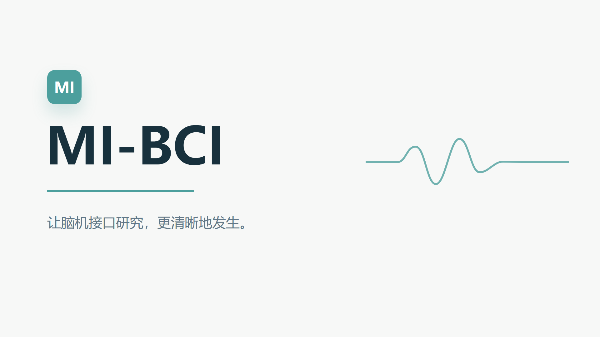
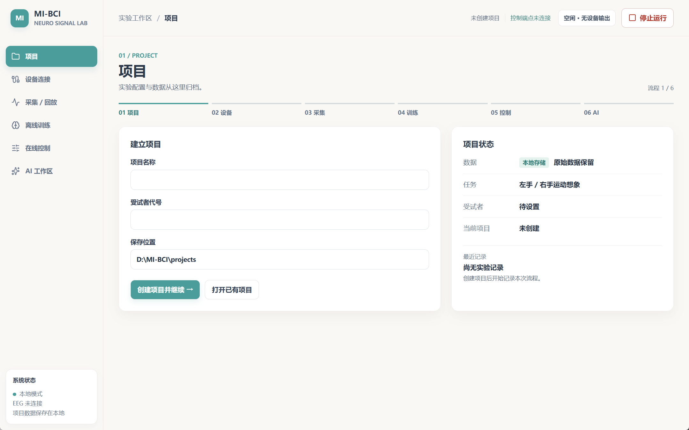
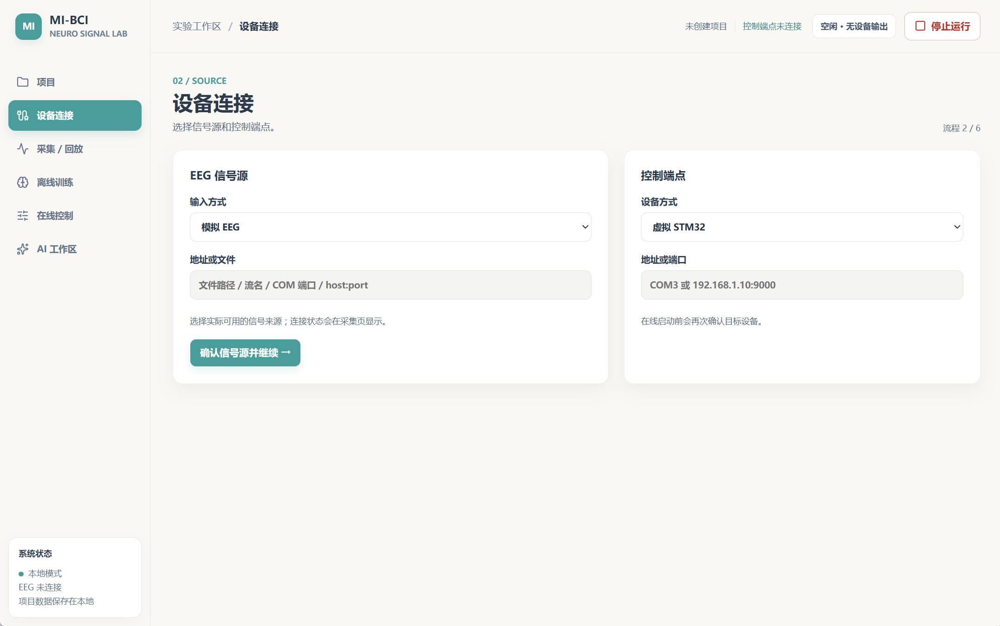
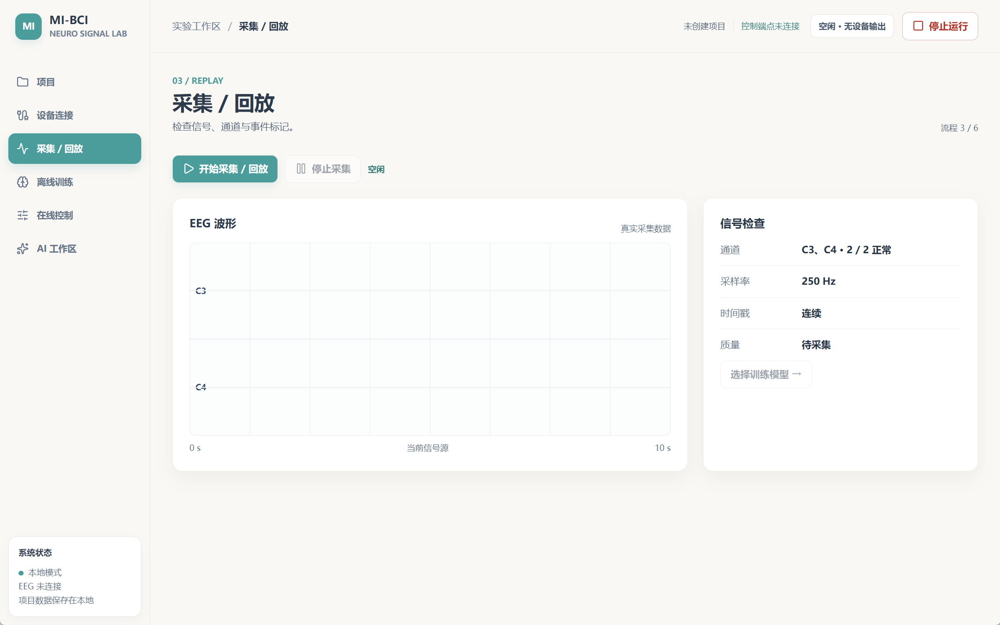
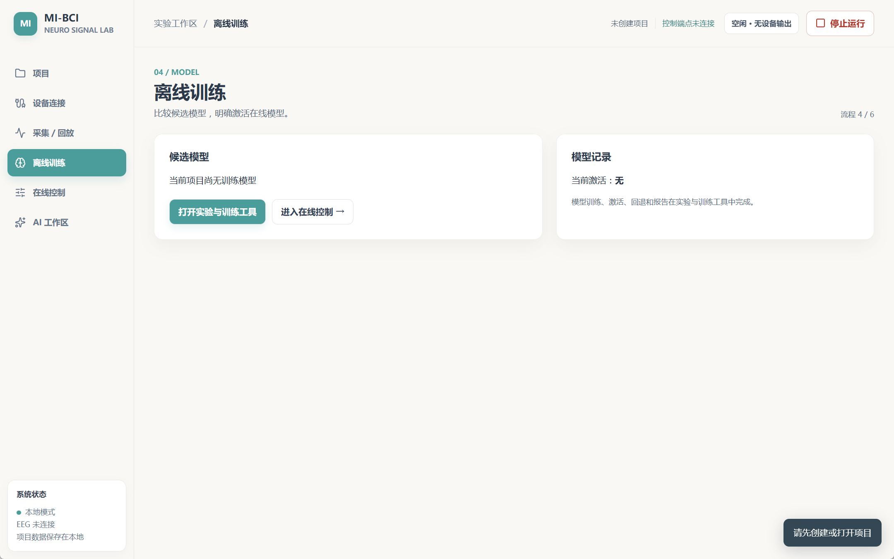
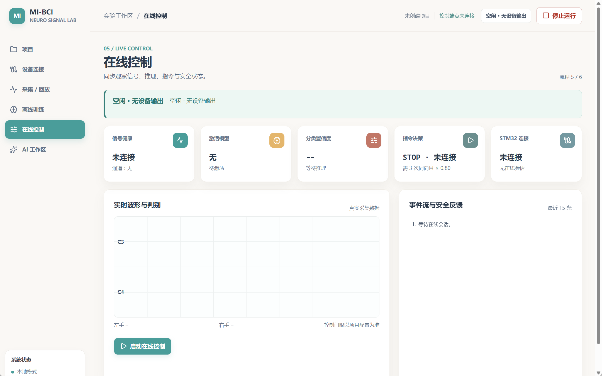
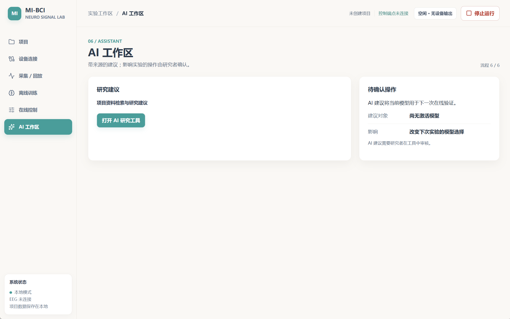
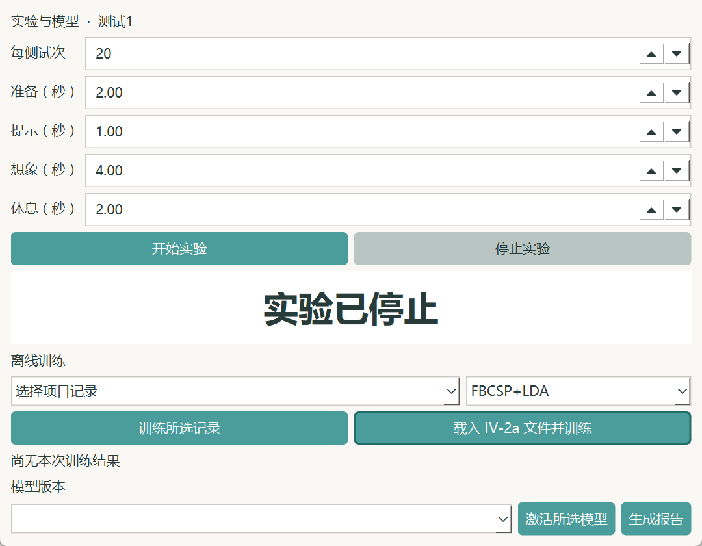

# MI-BCI

<div align="center">

## 首个开源的基于运动想象的脑电上位机 Agent

面向脑机接口研究者的 Windows 实验工作台：从脑电采集、运动想象实验、模型训练，到在线控制与 AI 辅助研究，统一在一个可追溯的项目中完成。

[宣传视频](#宣传视频) · [功能总览](#功能总览) · [界面预览](#界面预览) · [快速开始](#快速开始) · [安全边界](#数据与安全) · [开发与测试](#开发与测试)

</div>

> MI-BCI 是一个面向研究与原型验证的开源脑电上位机 Agent。它把“信号、模型、设备、实验记录和研究资料”组织成同一个可审计工作流，帮助研究者把运动想象实验从一次性演示推进到可复现的闭环。

## 宣传视频

[](assets/video/mi-bci-promo.mp4)

[观看 32 秒宣传视频](assets/video/mi-bci-promo.mp4) · By Xren

## 为什么做 MI-BCI

运动想象脑机接口通常需要在多个软件之间切换：采集工具、实验脚本、训练代码、设备控制和研究资料彼此分散，难以复盘一次实验到底使用了什么数据、模型和控制策略。

MI-BCI 将这些环节收拢到项目级工作流中。每个项目保存配置版本、原始来源、事件、模型元数据、控制记录和审计日志；研究者可以回放、训练、激活、回退并生成报告。

## 功能总览

| 工作流 | 你可以做什么 |
| --- | --- |
| 项目管理 | 创建和重开实验项目，保存配置修订、记录和审计事件 |
| 设备连接 | 使用模拟 EEG、CSV/EDF/BDF、LSL、串口、蓝牙串口或 TCP 信号源 |
| 采集与回放 | 查看 EEG 波形、频谱、通道健康和事件，回放已记录信号 |
| 运动想象实验 | 运行左右手视觉提示协议，记录准备、提示、想象、休息和停止事件 |
| 离线训练 | 使用本地校准记录或 BCI Competition IV-2a 数据训练 FBCSP+LDA / EEGNet |
| 在线控制 | 连接虚拟 STM32、串口或 TCP 设备，进行带确认、冷却和故障停止的控制 |
| AI 辅助研究 | 导入研究资料，检索来源，获取实验分析、训练建议和设备诊断，并由研究者审核 |
| 数据治理 | 保留原始来源和哈希，支持去标识导出、BIDS 兼容衍生文件和 SQLite 审计日志 |

## 闭环工作流

```text
项目 → 设备 → 采集/回放 → 运动想象实验 → 离线训练 → 在线控制 → AI 辅助研究
```

在线输出有明确的安全边界：低置信度、信号退化、时间戳异常、预测失败、设备 ACK 错误或连接断开都会阻止控制并尝试发送 STOP；故障后需要显式复位。真实外设仍必须在选定硬件上完成独立验收。

## 界面预览

### 研究工作台













### 运动想象实验配置



## 快速开始

### 环境

- Windows 桌面端工作流
- Python 3.11 或更高版本
- 核心数据层仅依赖 Python 标准库
- 采集、桌面、训练和 AI 能力通过可选依赖安装

### 运行核心测试

```powershell
$env:PYTHONPATH = 'src'
py -m unittest discover -s tests -v
```

### 启动桌面工作台

```powershell
py -m venv .venv
.\.venv\Scripts\python.exe -m pip install -e '.[desktop,acquisition,research,ai]'
$env:PYTHONPATH = 'src'
.\.venv\Scripts\python.exe -m mi_bci.workbench
```

如果只需要采集监视器，可以启动：

```powershell
.\.venv\Scripts\python.exe -m mi_bci.desktop
```

### 使用 Python 核心

```python
from pathlib import Path

from mi_bci import Project, ReplaySource, SyntheticSource

project = Project.create(Path("study"), "MI study", subject="01")
source = SyntheticSource(event_samples={100: "left", 300: "right"})
source.start()
blocks = []
while (block := source.read()) is not None:
    blocks.append(block)
recording_id = project.record("synthetic", blocks)

replay = ReplaySource(project, recording_id)
replay.start()
while (block := replay.read()) is not None:
    print(block.timestamps[0], block.events)
project.export_deidentified("study-export.zip")
project.close()
```

## 数据与安全

- SQLite 是记录、配置修订和审计事件的权威存储；每个采集块独立提交。
- 导入的原始文件保存在项目 `sourcedata`，去标识导出会移除原始来源、身份元数据、项目名、绝对时间起点和非标准自由文本标签。
- 去标识导出中的伪名只是本地项目标识，不等于参与者同意，也不等于波形数据已完成匿名化。
- AI 默认使用本地证据摘录；切换到 Ollama 或 OpenAI 兼容接口时，发送问题和证据前需要确认，密钥写入操作系统凭据库而不写入项目文件。
- MCP 服务只开放项目、模型、报告和日志的读取能力，不提供设备指令工具。
- STM32 参考协议包含 ACK、重复命令处理、输出看门狗和断链边界；它不是特定开发板的固件镜像。

## 开发与测试

项目包名为 `mi-bci-platform`，源码位于 `src/mi_bci`，测试位于 `tests`。桌面端使用 PySide6，FFT 使用 NumPy，EDF/BDF 使用 MNE-Python，LSL 使用 pylsl，串口使用 pyserial；训练和 AI 集成按需安装。

Windows 构建脚本位于 `release/build.ps1`，会生成桌面程序、只读 MCP 程序和按用户安装器。`release/validate_simulation.py` 可验证模拟闭环和最终 STOP；模拟结果不等于真实脑电或真实外设性能。

当前验证边界：核心、采集、研究和在线逻辑已有测试；完整 AI 测试需要安装 `.[ai]`，桌面测试需要安装 `.[desktop]`。真实设备、CUDA 加速和安装后启动/卸载仍需在目标环境验收。

## 参考资料

- [STM32 控制协议与集成参考](firmware/stm32_reference/README.md)
- [发布构建脚本](release/build.ps1)
- [项目依赖与可选能力](pyproject.toml)

## 许可证

本仓库当前未附带许可证文件。正式对外协作前，请补充项目许可证及第三方依赖的分发核查。
